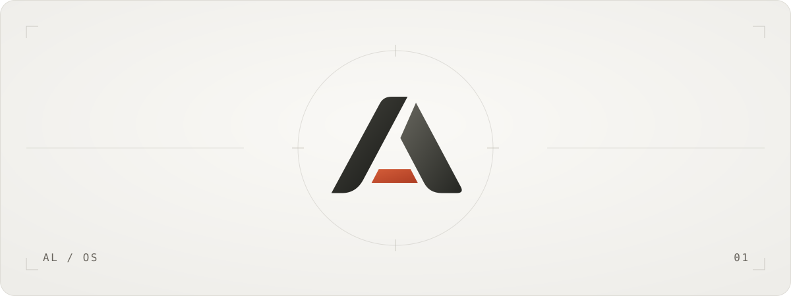

<picture>
  <source media="(prefers-color-scheme: dark)" srcset=".github/brand/cover-dark.svg">
  
</picture>

# AlacreOS

Il progetto è in fase di impostazione. Qui raccogliamo le prime decisioni; non ci sono ancora una build da avviare o una release da scaricare.

[Stato del progetto](docs/progetto.md) · [Come contribuire](CONTRIBUTING.md)
