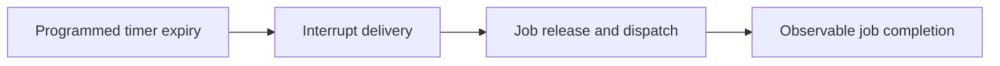

# Qualifying the first real-time profile

Use this checklist for each physical reference target. The [architecture specification](architecture-v0.1.md#first-milestone-acceptance-criteria) defines the acceptance criteria and the scope of each guarantee.

The [QEMU smoke test](kernel-development.md) supplies functional evidence for the boot path and dispatcher. The timing and energy records below come from physical reference targets.

## Record the configuration

| Record | Include |
| --- | --- |
| Platform | CPU and revision, board, firmware, timer, interrupt controller, active cores, memory topology, and any peripherals or DMA in scope. |
| Software | Kernel commit and binary identity, compiler and flags, boot settings, and the workload configuration. |
| Operating conditions | Power profile, allowed idle states, interrupt and interference limits, and thermal envelope. |
| Workload | Each task’s `C`, `Q`, `T`, `D`, and `J`, with the accounting scope and the source of each bound. Record the reference event and observable completion. |

## Trace the deadline

The first milestone sets a 100 µs deadline from programmed timer expiry to observable user-space job completion. Include interrupt delivery, dispatch, job execution, and admitted interference in the bound. Record the clock source, resolution, and placement of each trace point.

For an application deadline measured from a physical event, document the input and output paths as well. Report the analysis bound alongside the trace results. Traces can reveal a violation and corroborate the analysis. An upper bound requires independent justification.

## Collect the acceptance evidence

- Show two isolated user-space domains, with the kernel rejecting an unauthorized memory access and a capability invocation that lacks the required rights.
- Publish the task parameters and the admission analysis. Capture releases, preemption, EDF tie-breaking, and completion for admitted work, and record why the rejected configuration fails.
- Exercise IPC send, receive, queue saturation, and resource return. Record the `would_block` result and verify ownership and quotas after the failed send.
- Force one job to exhaust its budget. Measure the time to suspension, confirm that the supervisor can observe the fault, and verify that an independent job meets its deadline with the fault included in admission analysis.
- Record idle power, workload energy, completed work, and deadline misses. Report joules per completed unit, the measurement boundary and uncertainty, and the workload and run duration. Use equivalent boundaries when comparing the two ISAs.

Publish the configuration, analysis inputs, commands, and traces together so a reviewer can reproduce the result. Reassess admission whenever a change invalidates a recorded assumption.
